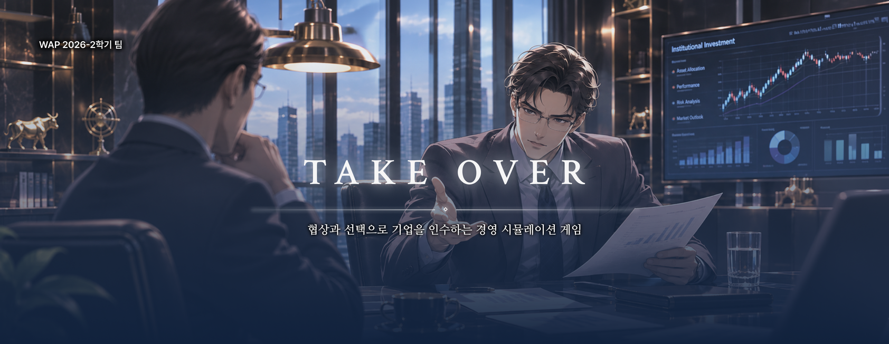
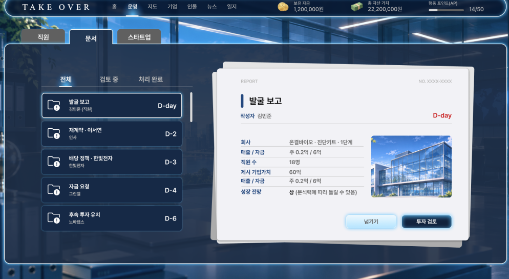
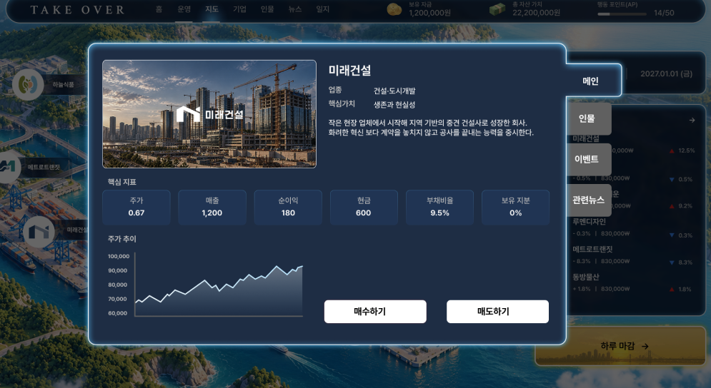
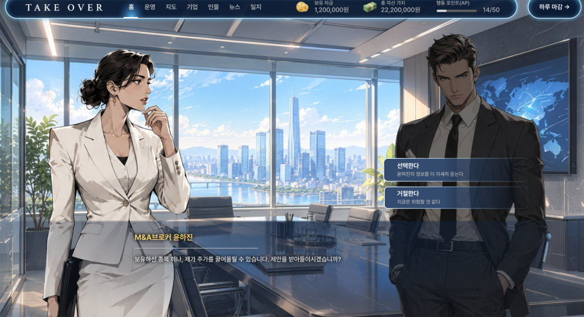
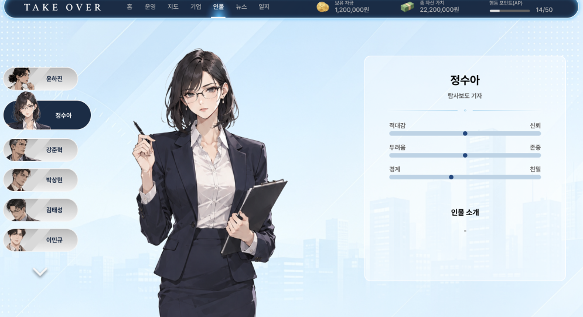

# TakeOver



**협상과 선택으로 기업을 인수하는 경영 시뮬레이션 게임**<br>
WAP 2026-2학기 게임 4팀

현재 구현 범위와 미정 설계를 이어받을 때는 [진행 상황 이전 기록](Docs/PROJECT_STATUS.md)을 먼저 확인하세요.

## 줄거리

1. **복수의 시작** — 그룹에 회사를 빼앗기고, 당신은 복수를 위해 투자회사를 세웠습니다.
2. **수상한 첫 거래** — 윤하진이 내민 미래건설. 정보가 진짜인지 확인하기 전까지는 움직일 수 없습니다.
3. **목표는 그룹 인수** — 지분을 쌓고, 사람을 만나고, 선택하세요. 누구를 지키고 누구를 버릴지.

> "복수를 끝낸 뒤, 당신은 어떤 경영자가 되어 있을까?"

## PART 1. 회사 운영

복수에는 돈이 듭니다. 직원을 모으고 시장을 읽으며 싸울 자금을 불리세요. 어떤 길을 택하든 그 결과는 당신이 짊어집니다.

| 운영 문서 | 매수·매도 |
| :---: | :---: |
|  |  |
| 유능한 직원을 모집하고 문서를 처리하며 회사들의 운영 방향을 결정 | 기업의 지표를 살펴보며 지분을 모으거나 시세 차익을 노림 |

## PART 2. 스토리 진행

복수를 위해 주변 회사들을 인수하세요. 굴복시킬지, 동료가 될 지는 여러분의 선택에 달려있습니다.

| 협상 | NPC 프로필 |
| :---: | :---: |
|  |  |
| 인물과 대화하며 선택지를 고르고, 선택마다 달라지는 대가를 감수 | 인물의 프로필과 쌓여 가는 관계를 확인하며 협상 상대를 파악 |

## 사용 도구

Unity · GitHub · Figma · Notion

## 이후 계획

추가 작업을 통해 최종 보스·다중 엔딩 구현, 이벤트 볼륨 및 밸런스 조정을 진행하고 2월 내 출시 목표

## 팀 소개

|  |  |  |  |  |
| :---: | :---: | :---: | :---: | :---: |
| [이광진 (팀장)](https://github.com/paul1405dev-hub) | [고현우](https://github.com/Mobyeol) | [이상엽](https://github.com/hksl0304) | [박성민](https://github.com/psm3489) | 정혜지 |
| 개발자 | 개발자 | 개발자 | 개발자 | 디자이너 |

## 개발 환경

### 요구 사항

- Unity **6000.3.6f1 (LTS)**
- Git / Git LFS

### 시작하기

```
git clone https://github.com/pknu-wap/TakeOver.git
```

Unity Hub에서 "Add project"로 클론한 폴더를 열면 된다.
